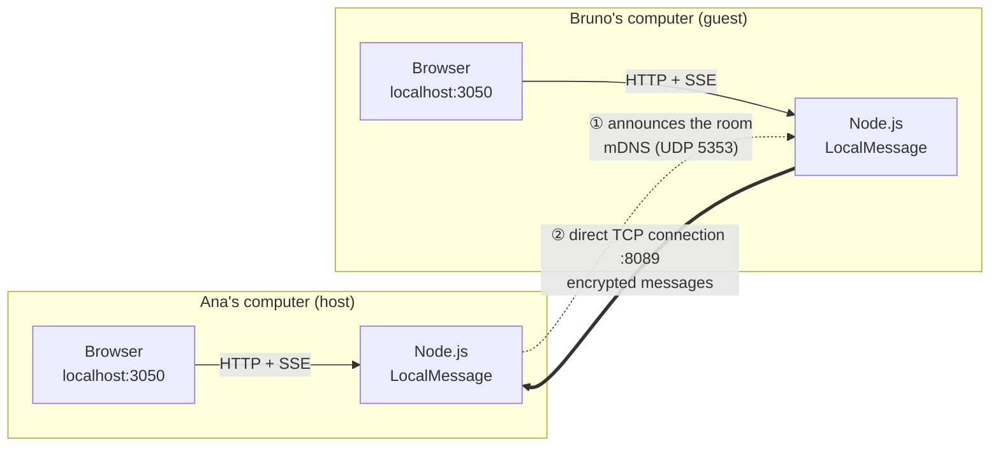
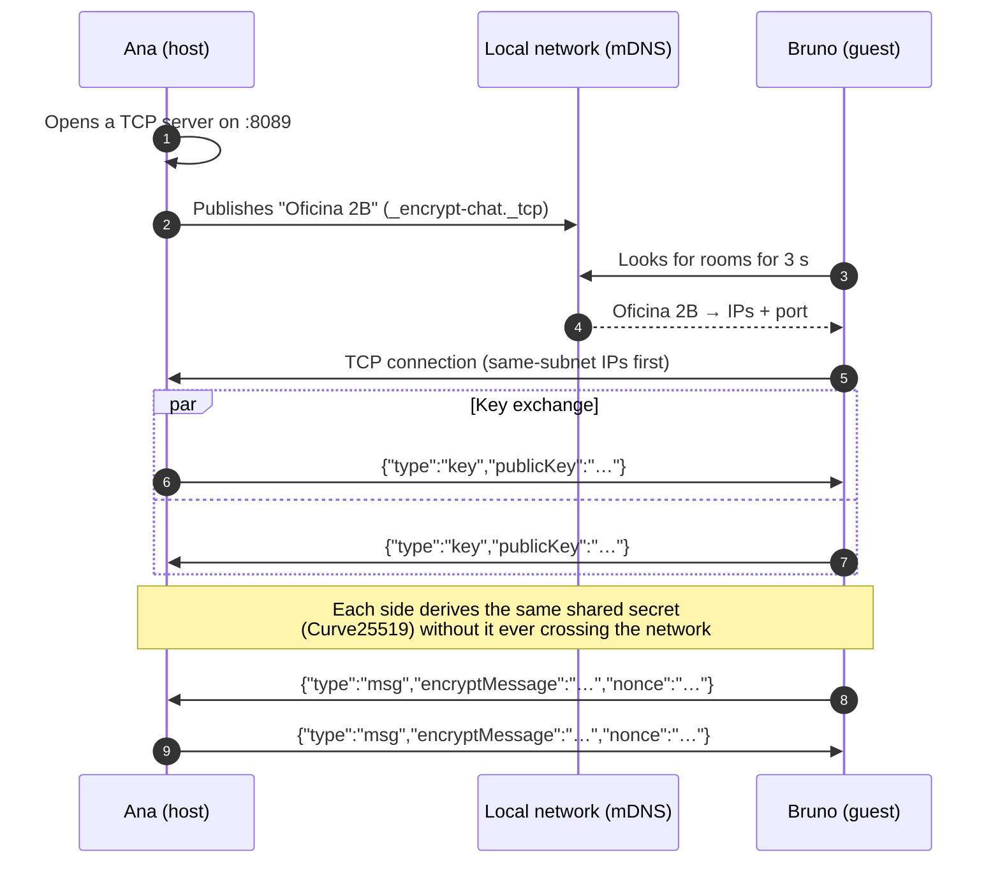

<div align="center">

# 🔒 LocalMessage

**Private 1-to-1 chat, end-to-end encrypted, between two computers on the same local network.**
No servers, no accounts, no internet.

[](https://nodejs.org/)
[](https://tweetnacl.js.org/)
[](https://github.com/onlxltd/bonjour-service)
[](package.json)
[](LICENSE)

[Español](README.md) · **English**


</div>

---

## Contents

- [What is it?](#what-is-it)
- [Features](#features)
- [Screenshots](#screenshots)
- [Requirements](#requirements)
- [Installation](#installation)
- [Usage](#usage)
- [How it works](#how-it-works)
- [Security](#security)
- [Configuration](#configuration)
- [Local API](#local-api)
- [Project structure](#project-structure)
- [Troubleshooting](#troubleshooting)
- [License](#license)

## What is it?

LocalMessage lets two people on the **same network** (office or home Wi-Fi, a lab) talk privately without relying on any outside service:

1. One person **creates a room**, which announces itself on the network.
2. The other **scans the network**, sees the room and **joins** with one click.
3. Both computers exchange keys and, from then on, **everything typed travels encrypted** straight from one computer to the other.

Nothing is written to disk: when you leave, the conversation is gone.

## Features

| | |
|---|---|
| 🔐 **End-to-end encryption** | NaCl `box` (Curve25519 + XSalsa20-Poly1305) with fresh keys on every connection. |
| 📡 **Automatic discovery** | Rooms are announced and found via mDNS/Bonjour: no IP addresses to type. |
| 🚫 **No central server** | A direct TCP connection between the two computers. No cloud, no accounts, no logs. |
| 🖥️ **Two interfaces** | A web page with a retro terminal look, or the console itself. |
| 👥 **Truly private** | A room accepts exactly one guest; any other attempt is rejected. |
| 🧹 **Ephemeral** | History lives in memory only and is wiped when you leave. |
| 🪶 **Lightweight** | Plain Node.js, no frameworks, only two dependencies (`bonjour-service` and `tweetnacl`). |

## Screenshots

<table>
<tr>
<td width="50%"></td>
<td width="50%"></td>
</tr>
<tr>
<td align="center"><b>1. Start screen</b><br><sub>Nickname, create a room or scan the network.</sub></td>
<td align="center"><b>2. Network scan</b><br><sub>Ana's room shows up on Bruno's computer by itself.</sub></td>
</tr>
<tr>
<td></td>
<td></td>
</tr>
<tr>
<td align="center"><b>3. Room created</b><br><sub>Broadcast on the network, waiting for someone.</sub></td>
<td align="center"><b>4. Encrypted conversation</b><br><sub>Bruno's (guest) view. Status switches to <code>ENCRYPTED LINK</code>.</sub></td>
</tr>
<tr>
<td></td>
<td align="center"></td>
</tr>
<tr>
<td align="center"><b>5. The other person leaves</b><br><sub>The room stays open, waiting for someone else.</sub></td>
<td align="center"><b>6. Responsive layout</b><br><sub>Works in narrow windows too.</sub></td>
</tr>
</table>

## Requirements

- **Node.js 20.6 or newer** (uses the `--env-file-if-exists` flag; tested on Node 24).
- **Both computers on the same network and subnet**, with multicast allowed (mDNS uses UDP 5353).
- On the computer that **creates** the room, **TCP port 8089** allowed through the firewall.

> On Windows, the first time you create a room the Firewall prompt appears: allow Node.js on **private networks**.

## Installation

```bash
git clone https://github.com/mitotkp/LocalMessageApp.git
cd LocalMessageApp
npm install
```

Optional, to change the web interface port:

```bash
cp .env.example .env
```

## Usage

Do the same on **both computers**: one creates the room, the other joins.

### Web interface (recommended)

```bash
npm run web
```

Open **http://localhost:3050** (the `WEB_PORT` value; without a `.env` it uses **3000**).

1. Type a **nickname** (remembered in that browser).
2. On one computer: **`[ CREATE ROOM ]`**, with an optional room name.
3. On the other: **`[ SCAN ]`** → the room shows up → **`[ JOIN ]`**.
4. Once the top-right status reads **`ENCRYPTED LINK`**, you can chat.
5. **`[ LEAVE ]`** closes the connection and stops announcing the room.

The status indicator always shows where you stand:

| Status | Meaning |
|---|---|
| `OFFLINE` | You are not in a room. |
| `WAITING FOR PEER` | You created a room and are waiting for someone to join. |
| `ENCRYPTED LINK` | Someone is connected and the key exchange is done. |
| `DISCONNECTED` | You joined a room and the other person left. |
| `RECONNECTING...` | The page lost contact with the local Node process. |

### Terminal mode

```bash
npm start
```

```text
Your nickname: ana
1) Create room   2) Join a room: 1
Room name: Oficina 2B
Room "Oficina 2B" created. Waiting for someone to join...
Someone connected from 10.10.10.25:51234. Type /exit to quit.
[01:23 PM] bruno: Hi Ana, can you read me?
> Loud and clear!
```

The person joining picks `2`, waits for the scan (3 s) and types the room number. Inside the chat, **`/exit`** quits. Both modes speak the same protocol: one person can use the web page and the other the terminal.

## How it works

### Overview



Each person runs their own copy of the app. The browser only talks to the Node process **on its own computer**; the two Node processes are the ones talking over the network.

### Step by step



1. **Create the room** (`src/receiver.js`, `src/service/discovery.js`): the host opens a TCP server on port 8089 and publishes the room over Bonjour as `_encrypt-chat._tcp`, with an `app=encrypt-chat-p2p` tag so it is not mistaken for other services.
2. **Find rooms**: the guest listens to the network for 3 seconds and keeps only announcements carrying that tag.
3. **Connect** (`src/transmittor.js`): a room may advertise several IPs (Wi-Fi, Ethernet, virtual adapters). The guest drops IPv6 and `169.254.x.x` self-assigned addresses, puts those on **its own subnet** first, and tries each with a 2-second timeout until one answers.
4. **Key exchange** (`src/events/tcpEvents.js`): as soon as the socket opens, each side generates a **brand-new key pair** and sends its public key. Using its own private key and the other's public key, each side computes the **same shared secret**, which never travels over the network.
5. **Messages** (`src/service/encryption.js`, `src/models/messageModel.js`): every message (`{author, text, sentAt}`) is turned into JSON, encrypted with the shared secret and a **random 24-byte nonce**, and sent as one JSON line. Poly1305 authenticates the content: a message tampered with in transit fails to decrypt and is discarded.
6. **Web interface** (`src/webServer.js`, `src/controllers/webController.js`): the browser sends actions with `fetch` and receives every update (messages, joins, disconnections) through **Server-Sent Events**, an HTTP connection the server keeps open.

### Wire protocol

TCP traffic is **newline-delimited JSON** (one frame per line, 64 KB max):

```jsonc
// 1. Key exchange (in the clear: a public key is not a secret)
{"type":"key","publicKey":"q8Jx…base64…="}

// 2. Messages (the nonce is the only readable part)
{"type":"msg","encryptMessage":"0a9F…base64…","nonce":"Zr7k…base64…"}
```

Anyone sniffing the network only sees public keys, nonces and encrypted bytes: **not the text, the nickname or the time** of a message.

## Security

**Encryption**

- NaCl `box` via [tweetnacl](https://tweetnacl.js.org/): Curve25519 for key agreement, XSalsa20 for encryption and Poly1305 for authentication.
- **Ephemeral** keys: generated per connection and never stored. A past conversation cannot be decrypted later, even if someone gains access to the computer.

**Input handling**

- Nicknames up to 32 characters, room names up to 60 and messages up to 2000.
- Control characters are stripped, so the other side cannot inject ANSI sequences that tamper with the terminal.
- The web page inserts everything with `textContent` (never `innerHTML`): a message cannot inject HTML or scripts.
- Frames over 64 KB drop the connection; HTTP bodies over 16 KB are rejected.

**Web interface**

- Listens on **`127.0.0.1`** only: nobody else on the network can open your page or drive your chat.
- Validates the `Host` and `Origin` headers, blocking *DNS rebinding* and requests from other websites open in your browser.
- `POST` requests require `Content-Type: application/json`, which forces the browser to ask for CORS permission that this server never grants.
- Static files cannot escape `public/` (protection against `../` paths).

> [!WARNING]
> **Known limitation:** the key exchange is **not authenticated** (no fingerprint check or room password). LocalMessage protects against someone **passively listening** on the network, but not against an **active** attacker on the same LAN impersonating the room (*man-in-the-middle*). Use it on trusted networks.

## Configuration

| Variable | Where | Purpose | Default |
|---|---|---|---|
| `WEB_PORT` | `.env` | Web interface port (`npm run web`). | `3000` |

Other values in `src/config/index.js`:

| Key | Purpose | Value |
|---|---|---|
| `network.defaultPort` | TCP port for rooms. | `8089` |
| `network.host` | Interface the room listens on. | `0.0.0.0` |
| `discovery.type` | Bonjour service type. | `encrypt-chat` |
| `discovery.txt.app` | Tag that identifies this app's rooms. | `encrypt-chat-p2p` |

## Local API

Used by the web page; reachable from `127.0.0.1` only. `POST` requests require `Content-Type: application/json`.

| Method | Path | Body | What it does |
|---|---|---|---|
| `GET` | `/api/rooms` | — | Scans the network for 3 s and returns `[{id, name, host}]`. |
| `POST` | `/api/rooms` | `{nick, roomName}` | Creates and announces a room. |
| `POST` | `/api/join` | `{nick, roomId}` | Joins a room from the latest scan. |
| `POST` | `/api/messages` | `{text}` | Sends an encrypted message. |
| `POST` | `/api/leave` | — | Leaves the room and stops announcing it. |
| `GET` | `/api/events` | — | SSE stream: `{type:"state"}` and `{type:"entry"}`. |

State lives in the Node process, not in the tab: if you open several tabs, they all show the same conversation.

## Project structure

```text
LocalMessageApp/
├── public/                      Web interface (HTML, CSS and JS, no frameworks)
│   ├── index.html
│   ├── app.js                   Page logic: actions, rendering, SSE
│   └── styles.css               Retro terminal look, responsive
├── src/
│   ├── index.js                 Terminal mode entry point (npm start)
│   ├── web.js                   Web mode entry point (npm run web)
│   ├── webServer.js             HTTP server: API, SSE, static files
│   ├── receiver.js              Room TCP server (host)
│   ├── transmittor.js           Connecting to a room (guest)
│   ├── config/index.js          Port, host and discovery settings
│   ├── controllers/
│   │   ├── chatController.js    Chat flow in the console
│   │   └── webController.js     Same flow, driven from the browser
│   ├── events/tcpEvents.js      Encrypted channel over the TCP socket
│   ├── models/messageModel.js   Message format, limits and sanitizing
│   └── service/
│       ├── discovery.js         Publishing and finding rooms (Bonjour)
│       └── encryption.js        Keys and encryption (tweetnacl)
└── docs/screenshots/            Screenshots used in this README
```

## Troubleshooting

<details>
<summary><b>The scan finds no rooms</b></summary>

- Make sure both computers are on the **same network and subnet** (e.g. both on `192.168.1.x`).
- Many guest Wi-Fi networks enable **client isolation**, which keeps devices from seeing each other.
- The firewall must allow **mDNS (UDP 5353)**. On Windows, check that the network is set to **Private**.
- Wait until the room shows `WAITING FOR PEER` before scanning.
</details>

<details>
<summary><b>The room shows up, but joining says <code>Could not connect to room</code></b></summary>

The host's firewall is blocking **TCP 8089**. Allow Node.js on private networks or open that port.
</details>

<details>
<summary><b><code>Could not create the room: listen EADDRINUSE</code></b></summary>

Port 8089 is already in use, usually by another room open on the same computer. There can be only **one room per computer**; close the other one or change `network.defaultPort`.
</details>

<details>
<summary><b>The page shows <code>RECONNECTING...</code></b></summary>

The Node process stopped. Run `npm run web` again; the page reconnects by itself.
</details>

## License

[ISC](LICENSE)
