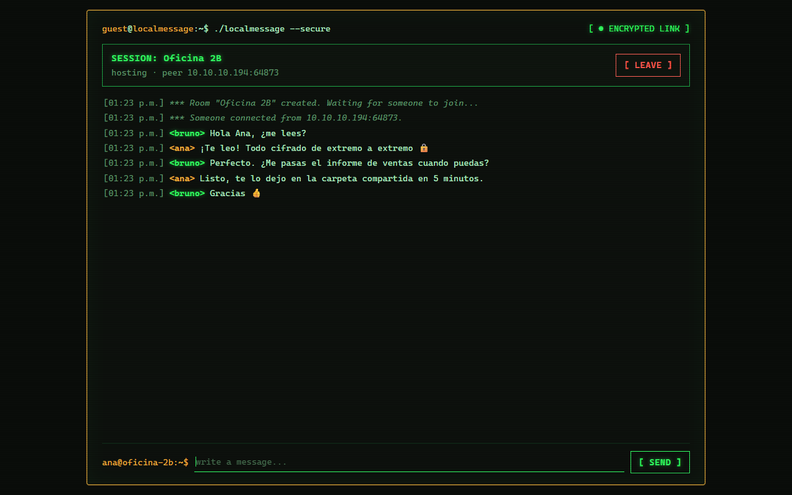
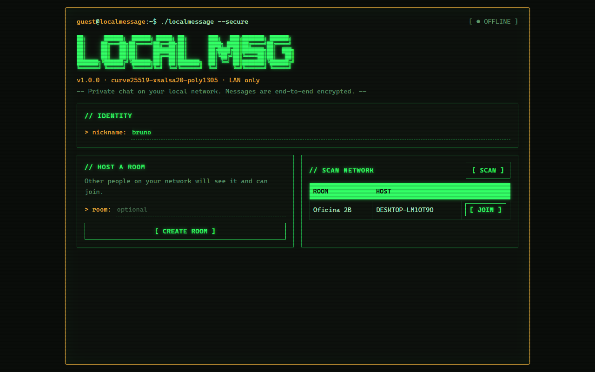
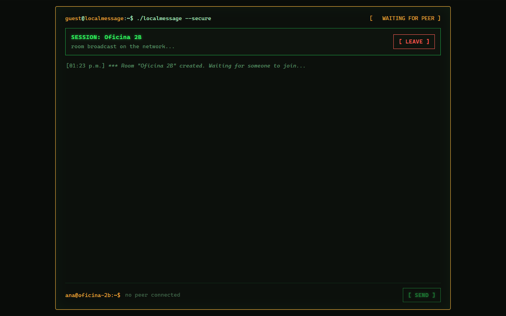
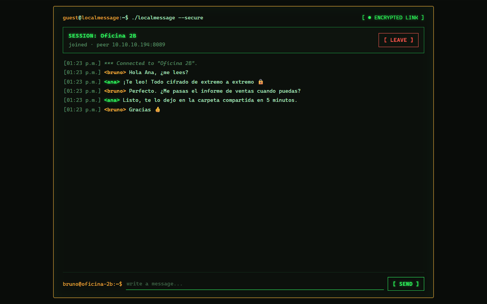
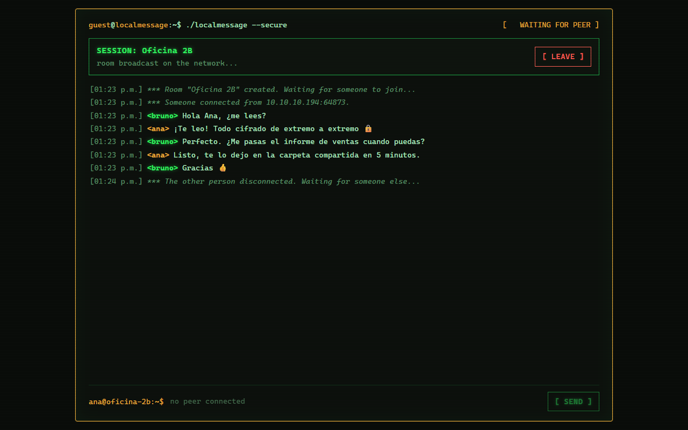
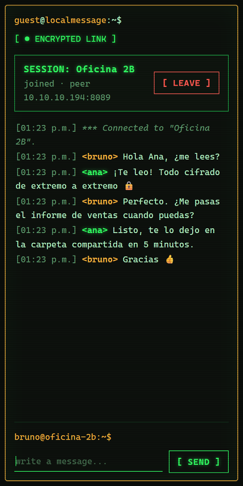
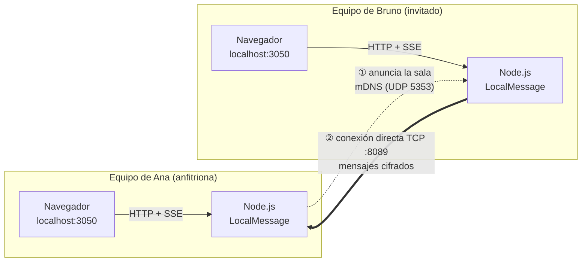
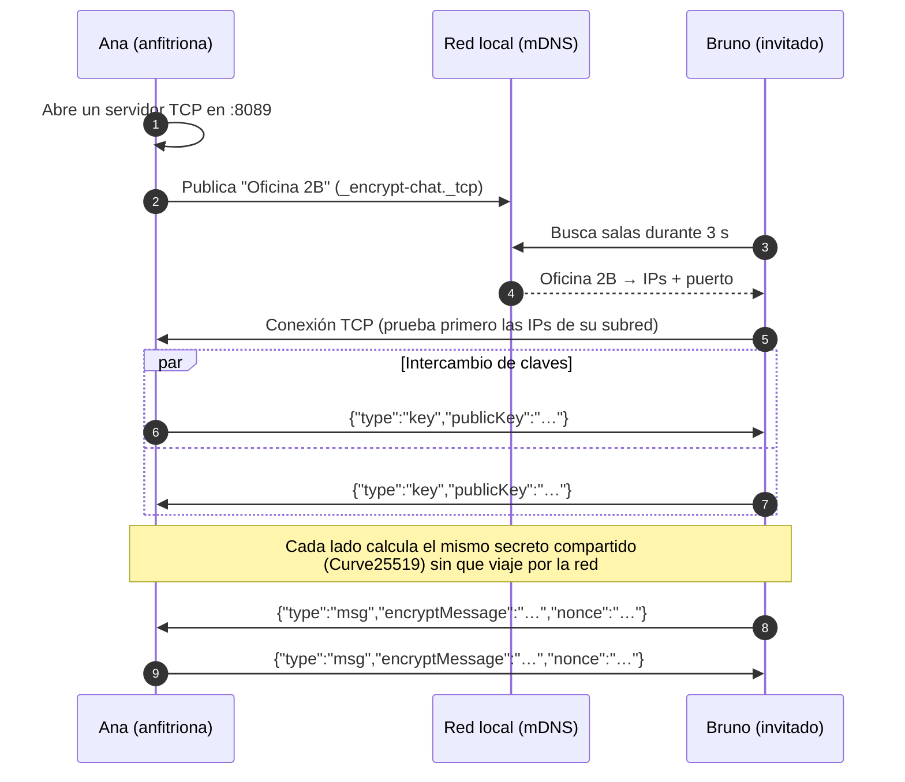

<div align="center">

# 🔒 LocalMessage

**Chat privado 1 a 1, cifrado de extremo a extremo, entre dos equipos de la misma red local.**
Sin servidores, sin cuentas, sin internet.

[](https://nodejs.org/)
[](https://tweetnacl.js.org/)
[](https://github.com/onlxltd/bonjour-service)
[](package.json)
[](LICENSE)

**Español** · [English](README.en.md)



</div>

---

## Contenido

- [¿Qué es?](#qué-es)
- [Características](#características)
- [Capturas](#capturas)
- [Requisitos](#requisitos)
- [Instalación](#instalación)
- [Uso](#uso)
- [Cómo funciona](#cómo-funciona)
- [Seguridad](#seguridad)
- [Configuración](#configuración)
- [API local](#api-local)
- [Estructura del proyecto](#estructura-del-proyecto)
- [Solución de problemas](#solución-de-problemas)
- [Licencia](#licencia)

## ¿Qué es?

LocalMessage permite que dos personas conectadas a la **misma red** (la Wi-Fi de la oficina, de la casa, un laboratorio) conversen en privado sin depender de ningún servicio externo:

1. Una persona **crea una sala**, que se anuncia sola en la red.
2. La otra **escanea la red**, ve la sala y se **une** con un clic.
3. Los dos equipos intercambian claves y, desde ese momento, **todo lo que se escribe viaja cifrado** directamente de un equipo al otro.

Nada se guarda en disco: al salir, la conversación desaparece.

## Características

| | |
|---|---|
| 🔐 **Cifrado de extremo a extremo** | NaCl `box` (Curve25519 + XSalsa20-Poly1305) con claves nuevas en cada conexión. |
| 📡 **Descubrimiento automático** | Las salas se anuncian y se encuentran por mDNS/Bonjour: no hace falta conocer ninguna IP. |
| 🚫 **Sin servidor central** | La conexión es directa entre los dos equipos (TCP). No hay nube, ni cuentas, ni registros. |
| 🖥️ **Dos interfaces** | Una página web con estética de terminal retro, o directamente la consola. |
| 👥 **Privado de verdad** | Una sala admite exactamente una persona invitada; los demás intentos se rechazan. |
| 🧹 **Efímero** | El historial vive solo en memoria y se borra al salir. |
| 🪶 **Ligero** | Node.js puro, sin frameworks, con solo dos dependencias (`bonjour-service` y `tweetnacl`). |

## Capturas

<table>
<tr>
<td width="50%"></td>
<td width="50%"></td>
</tr>
<tr>
<td align="center"><b>1. Pantalla inicial</b><br><sub>Apodo, crear sala o escanear la red.</sub></td>
<td align="center"><b>2. Escaneo de la red</b><br><sub>La sala de Ana aparece sola en el equipo de Bruno.</sub></td>
</tr>
<tr>
<td></td>
<td></td>
</tr>
<tr>
<td align="center"><b>3. Sala creada</b><br><sub>Anunciada en la red, esperando a alguien.</sub></td>
<td align="center"><b>4. Conversación cifrada</b><br><sub>Vista de Bruno (invitado). El estado pasa a <code>ENCRYPTED LINK</code>.</sub></td>
</tr>
<tr>
<td></td>
<td align="center"></td>
</tr>
<tr>
<td align="center"><b>5. La otra persona sale</b><br><sub>La sala sigue abierta esperando a alguien más.</sub></td>
<td align="center"><b>6. Diseño adaptable</b><br><sub>También funciona en ventanas angostas.</sub></td>
</tr>
</table>

## Requisitos

- **Node.js 20.6 o superior** (usa la opción `--env-file-if-exists`; probado con Node 24).
- Los **dos equipos en la misma red y subred**, con multicast permitido (mDNS usa UDP 5353).
- En el equipo que **crea** la sala, el puerto **TCP 8089** permitido en el firewall.

> En Windows, la primera vez que se crea una sala aparece el aviso del Firewall: hay que permitir a Node.js en **redes privadas**.

## Instalación

```bash
git clone https://github.com/mitotkp/LocalMessageApp.git
cd LocalMessageApp
npm install
```

Opcional, para cambiar el puerto de la interfaz web:

```bash
cp .env.example .env
```

## Uso

Se hace lo mismo en los **dos equipos**: uno crea la sala y el otro se une.

### Interfaz web (recomendada)

```bash
npm run web
```

Abrir **http://localhost:3050** (el puerto de `WEB_PORT`; sin `.env` se usa el **3000**).

1. Escribir un **apodo** (se recuerda en ese navegador).
2. En un equipo: **`[ CREATE ROOM ]`**, con un nombre de sala opcional.
3. En el otro: **`[ SCAN ]`** → aparece la sala → **`[ JOIN ]`**.
4. Cuando el estado arriba a la derecha dice **`ENCRYPTED LINK`**, ya se puede chatear.
5. **`[ LEAVE ]`** cierra la conexión y deja de anunciar la sala.

El indicador de estado muestra en todo momento la situación:

| Estado | Significado |
|---|---|
| `OFFLINE` | No estás en ninguna sala. |
| `WAITING FOR PEER` | Creaste una sala y esperas a que alguien entre. |
| `ENCRYPTED LINK` | Hay alguien conectado y el intercambio de claves terminó. |
| `DISCONNECTED` | Te uniste a una sala y la otra persona se fue. |
| `RECONNECTING...` | La página perdió contacto con el proceso local de Node. |

### Modo terminal

```bash
npm start
```

```text
Your nickname: ana
1) Create room   2) Join a room: 1
Room name: Oficina 2B
Room "Oficina 2B" created. Waiting for someone to join...
Someone connected from 10.10.10.25:51234. Type /exit to quit.
[01:23 PM] bruno: Hola Ana, ¿me lees?
> ¡Te leo!
```

Quien se une elige `2`, espera el escaneo (3 s) y escribe el número de la sala. Dentro del chat, **`/exit`** sale. Los dos modos son compatibles entre sí: una persona puede usar la web y la otra la terminal.

## Cómo funciona

### Vista general



Cada persona ejecuta su propia copia de la aplicación. El navegador solo habla con el proceso de Node **de su mismo equipo**; los dos procesos de Node son los que hablan entre sí por la red.

### Paso a paso



1. **Crear la sala** (`src/receiver.js`, `src/service/discovery.js`): el anfitrión abre un servidor TCP en el puerto 8089 y publica la sala por Bonjour con el tipo `_encrypt-chat._tcp` y una marca `app=encrypt-chat-p2p` para no confundirla con otros servicios.
2. **Buscar salas**: el invitado escucha la red durante 3 segundos y se queda solo con los anuncios que llevan esa marca.
3. **Conectar** (`src/transmittor.js`): una sala puede anunciar varias IPs (Wi-Fi, cable, adaptadores virtuales). El invitado descarta las IPv6 y las de autoconfiguración `169.254.x.x`, ordena primero las que están en **su misma subred** y prueba cada una con 2 segundos de límite hasta que una responde.
4. **Intercambio de claves** (`src/events/tcpEvents.js`): apenas se abre el socket, cada lado genera un **par de claves nuevo** y envía su clave pública. Con la clave privada propia y la pública ajena, los dos calculan el **mismo secreto compartido** sin que este viaje nunca por la red.
5. **Mensajes** (`src/service/encryption.js`, `src/models/messageModel.js`): cada mensaje (`{author, text, sentAt}`) se convierte a JSON, se cifra con el secreto compartido y un **nonce aleatorio de 24 bytes**, y se envía en una línea JSON. Poly1305 autentica el contenido: si un mensaje fue alterado en el camino, no se puede descifrar y se descarta.
6. **Interfaz web** (`src/webServer.js`, `src/controllers/webController.js`): el navegador envía acciones con `fetch` y recibe todas las novedades (mensajes, conexiones, desconexiones) por **Server-Sent Events**, una conexión HTTP que el servidor mantiene abierta.

### Protocolo en la red

El tráfico TCP es **JSON delimitado por saltos de línea** (una trama por línea, máximo 64 KB):

```jsonc
// 1. Intercambio de claves (en claro: una clave pública no es secreta)
{"type":"key","publicKey":"q8Jx…base64…="}

// 2. Mensajes (lo único legible es el nonce)
{"type":"msg","encryptMessage":"0a9F…base64…","nonce":"Zr7k…base64…"}
```

Quien escuche la red solo ve claves públicas, nonces y bytes cifrados: **ni el texto, ni el apodo, ni la hora** del mensaje.

## Seguridad

**Cifrado**

- NaCl `box` vía [tweetnacl](https://tweetnacl.js.org/): Curve25519 para el acuerdo de claves, XSalsa20 para cifrar y Poly1305 para autenticar.
- Claves **efímeras**: se generan en cada conexión y no se guardan. Una conversación pasada no se puede descifrar más adelante aunque alguien obtenga acceso al equipo.

**Entrada de datos**

- Apodos de máximo 32 caracteres, nombres de sala de 60 y mensajes de 2000.
- Se eliminan los caracteres de control, para que la otra persona no pueda inyectar secuencias ANSI que alteren la terminal.
- La página web inserta todo con `textContent` (nunca `innerHTML`): un mensaje no puede inyectar HTML ni scripts.
- Tramas de más de 64 KB cortan la conexión; cuerpos HTTP de más de 16 KB se rechazan.

**Interfaz web**

- Escucha solo en **`127.0.0.1`**: nadie más en la red puede abrir tu página ni controlar tu chat.
- Valida las cabeceras `Host` y `Origin`, lo que bloquea ataques de *DNS rebinding* y peticiones desde otras páginas web abiertas en tu navegador.
- Los `POST` exigen `Content-Type: application/json`, lo que obliga al navegador a pedir permiso CORS, que este servidor nunca concede.
- Los archivos estáticos no pueden salir de `public/` (protección contra rutas con `../`).

> [!WARNING]
> **Limitación conocida:** el intercambio de claves **no está autenticado** (no hay verificación de huellas ni contraseña de sala). LocalMessage protege contra quien **solo escucha** la red, pero no contra un atacante **activo** dentro de la misma LAN que se haga pasar por la sala (ataque *man-in-the-middle*). Úsalo en redes de confianza.

## Configuración

| Variable | Dónde | Uso | Por defecto |
|---|---|---|---|
| `WEB_PORT` | `.env` | Puerto de la interfaz web (`npm run web`). | `3000` |

Otros valores en `src/config/index.js`:

| Clave | Uso | Valor |
|---|---|---|
| `network.defaultPort` | Puerto TCP de las salas. | `8089` |
| `network.host` | Interfaz donde escucha la sala. | `0.0.0.0` |
| `discovery.type` | Tipo de servicio Bonjour. | `encrypt-chat` |
| `discovery.txt.app` | Marca que identifica las salas de esta app. | `encrypt-chat-p2p` |

## API local

Usada por la página web; solo accesible desde `127.0.0.1`. Los `POST` requieren `Content-Type: application/json`.

| Método | Ruta | Cuerpo | Qué hace |
|---|---|---|---|
| `GET` | `/api/rooms` | — | Escanea la red 3 s y devuelve `[{id, name, host}]`. |
| `POST` | `/api/rooms` | `{nick, roomName}` | Crea y anuncia una sala. |
| `POST` | `/api/join` | `{nick, roomId}` | Se une a una sala del último escaneo. |
| `POST` | `/api/messages` | `{text}` | Envía un mensaje cifrado. |
| `POST` | `/api/leave` | — | Sale de la sala y deja de anunciarla. |
| `GET` | `/api/events` | — | Stream SSE: `{type:"state"}` y `{type:"entry"}`. |

El estado vive en el proceso de Node, no en la pestaña: si se abren varias pestañas, todas muestran la misma conversación.

## Estructura del proyecto

```text
LocalMessageApp/
├── public/                      Interfaz web (HTML, CSS y JS sin frameworks)
│   ├── index.html
│   ├── app.js                   Lógica de la página: acciones, renderizado, SSE
│   └── styles.css               Estética de terminal retro, adaptable
├── src/
│   ├── index.js                 Entrada del modo terminal (npm start)
│   ├── web.js                   Entrada del modo web (npm run web)
│   ├── webServer.js             Servidor HTTP: API, SSE, archivos estáticos
│   ├── receiver.js              Servidor TCP de la sala (anfitrión)
│   ├── transmittor.js           Conexión a una sala (invitado)
│   ├── config/index.js          Puerto, host y datos de descubrimiento
│   ├── controllers/
│   │   ├── chatController.js    Flujo de chat en la consola
│   │   └── webController.js     Mismo flujo, controlado desde el navegador
│   ├── events/tcpEvents.js      Canal cifrado sobre el socket TCP
│   ├── models/messageModel.js   Formato, límites y limpieza de mensajes
│   └── service/
│       ├── discovery.js         Publicar y buscar salas (Bonjour)
│       └── encryption.js        Claves y cifrado (tweetnacl)
└── docs/screenshots/            Capturas de este README
```

## Solución de problemas

<details>
<summary><b>El escaneo no encuentra ninguna sala</b></summary>

- Confirmar que los dos equipos están en la **misma red y subred** (por ejemplo, ambos en `192.168.1.x`).
- Muchas redes Wi-Fi de invitados activan el **aislamiento de clientes**, que impide que los equipos se vean entre sí.
- El firewall debe permitir **mDNS (UDP 5353)**. En Windows, comprobar que la red esté marcada como **Privada**.
- Esperar a que la sala muestre `WAITING FOR PEER` antes de escanear.
</details>

<details>
<summary><b>La sala aparece, pero al unirse dice <code>Could not connect to room</code></b></summary>

El firewall del anfitrión está bloqueando el **TCP 8089**. Permitir a Node.js en redes privadas o abrir ese puerto.
</details>

<details>
<summary><b><code>Could not create the room: listen EADDRINUSE</code></b></summary>

El puerto 8089 ya está en uso, normalmente por otra sala abierta en el mismo equipo. Solo puede haber **una sala por equipo**; cerrar la otra o cambiar `network.defaultPort`.
</details>

<details>
<summary><b>La página muestra <code>RECONNECTING...</code></b></summary>

El proceso de Node se detuvo. Volver a ejecutar `npm run web`; la página se reconecta sola.
</details>

## Licencia

[ISC](LICENSE)
